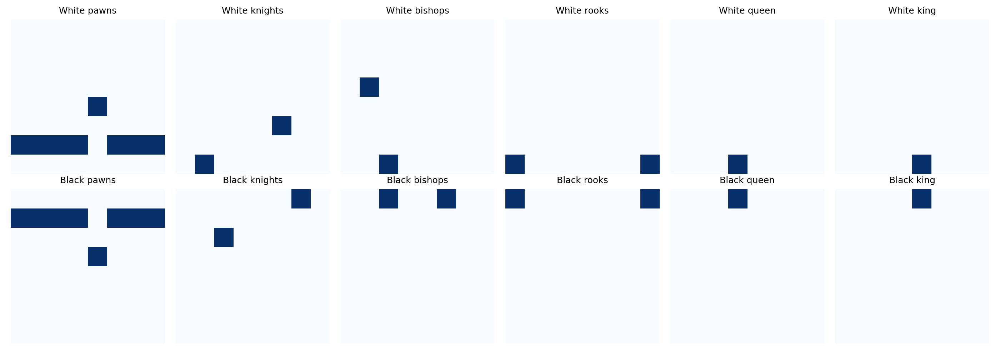
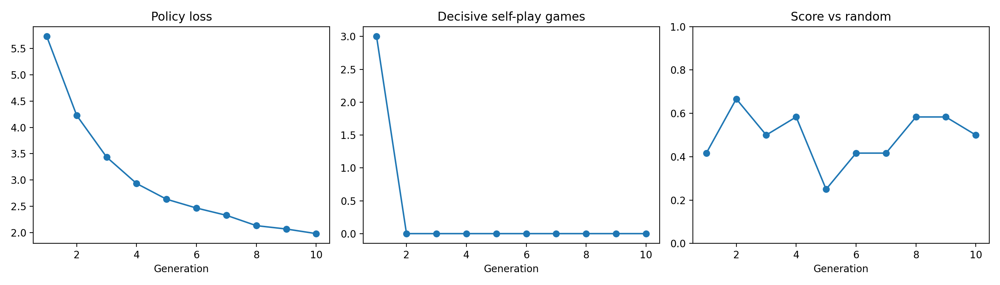
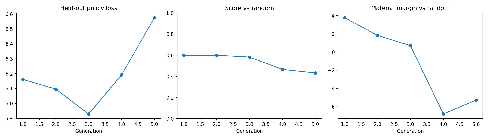

# Chess RL
Author: Mohamed Mazen Elagamy
A chess agent that learns by playing itself. It is built from scratch in PyTorch: a policy/value neural network, Monte Carlo Tree Search, and a self-play training loop, in the style of AlphaZero but scaled down to run on a laptop.

> **Status: work in progress, with an honest negative result.** The full pipeline runs end to end, but learning from the agent's own search did not improve it. In 30-game evaluations against a random player, every network trained that way scores lower than the *untrained* network with search, and self-play also made the best warm start (a value head pretrained on material) clearly worse. Distilling a deeper search on diverse positions is the first approach to train a policy that does not hurt, but iterating it degraded the agent after about three generations. A supervised bootstrap on Stockfish-evaluated positions is the first approach that clearly improves the agent (17 wins, 13 draws and no losses against a random player, against 13 / 16 / 1 for the untrained network). This README documents the experiments, what each one showed, and what is being tried next.

## Why this project

Most chess AI demos wrap an existing engine. This project implements the learning loop itself and measures how well it works, including where it fails. The aim is to understand reinforcement learning from the inside: what the search does, what the network learns, and what goes wrong when the training signal is weak.

## How it works


### 1. Seeing the board

The network cannot read a chess board, so each position becomes a tensor of shape 13 x 8 x 8: twelve planes for the pieces (six types, two colors) and one plane that is all ones when White is to move.



### 2. The network

Three 3x3 convolutional layers (64 channels) feed two heads:

- **Policy head:** 4096 scores, one per (from-square, to-square) pair. A 1x1 convolution compresses the features first, which keeps the head small. Illegal moves are masked out before the softmax, so they get exactly zero probability.
- **Value head:** a single number in [-1, 1] estimating how good the position is for the player to move.

About 2.2 million parameters in total.

### 3. Search (Monte Carlo Tree Search)

Each move runs a number of simulations. Each simulation walks down the tree choosing the child with the best PUCT score:

```
score = -Q(child) + cPuct * prior * sqrt(parent visits) / (1 + child visits)
```

At an unexplored position the network supplies the priors (policy) and the evaluation (value), and the result is backed up the path with the sign flipped at every ply. Checkmate is detected exactly (value -1 for the side that is mated). The visit counts at the root form the **search policy**, which is both the agent's move choice and its training target. During self-play, Dirichlet noise is mixed into the root priors for exploration.

### 4. Self-play and training

The agent plays full games against itself. Every position becomes a training example:

| Part | Meaning |
|---|---|
| State | the 13 x 8 x 8 board tensor |
| Policy target | visit probabilities from the search |
| Value target | depends on the experiment: game result, or material balance (see Experiments) |

Loss = cross-entropy on the policy + mean squared error on the value. Examples go into a replay buffer, and each generation trains on random batches from it. After each generation the loop logs metrics to a CSV, plays an evaluation match, and saves a checkpoint.

## How strength is measured

All evaluations are against a random-move player, alternating colors, with games capped at 200 plies (unfinished games count as draws). The agent uses 25 search simulations per move.

- **Score** = (wins + 0.5 x draws) / games. 0.5 means no better than the opponent.
- **Material margin** = the agent's average material lead (pawn 1, knight 3, bishop 3, rook 5, queen 9) over the opponent when each game ends.

The margin was added because the win/draw score cannot see progress when games rarely end in checkmate. In a test with a simple player that always takes the best available capture, the score was 0.57 against random but the margin was +26.7, versus about +1 for random vs random.

Samples are small (30 games), so differences of a few margin points are within noise.

## Performance engineering

Profiling the search showed that the network's dense layers took about half of the time, almost all of it in the 4096-wide policy head, and that copying the board (with its move history) grew with game length.

| | Before | After |
|---|---|---|
| Time for 50 simulations (CPU, opening position) | 0.47 s | 0.16 s |
| Network parameters | about 16.9 M | about 2.2 M |
| Checkpoint size | about 67 MB | about 9 MB |

Changes: a 1x1 convolution before the policy head, and `board.copy(stack=False)` inside the search.

## Results

30 games each, against a random player, 25 simulations per move, `cPuct` 1.5 unless noted.

| Player | W / D / L | Score | Material margin |
|---|---|---|---|
| Untrained network (Gen 0) + search | 13 / 16 / 1 | **0.70** | **+4.5** |
| Run 1, gen 10 (pure self-play) | 1 / 29 / 0 | 0.52 | -7.7 |
| Run 2b, gen 10 (material scoring of drawn games) | 1 / 24 / 5 | 0.43 | -8.9 |
| Run 3, gen 5 (+ root noise) | 2 / 24 / 4 | 0.47 | -9.9 |
| Run 3, gen 10 | 0 / 25 / 5 | 0.42 | -10.1 |
| Run 3, gen 10, policy ignored (uniform priors) | 2 / 27 / 1 | 0.52 | -2.1 |
| Run 3, gen 10, value ignored (value = 0) | 1 / 27 / 2 | 0.48 | -12.8 |
| Run 4, gen 5 (dense material value targets) | 1 / 24 / 5 | 0.43 | -12.3 |
| Run 4, gen 10 | 2 / 26 / 2 | 0.50 | -9.4 |
| Value head pretrained on material (no self-play) | 0 / 29 / 1 | 0.48 | +8.0 |
| Untrained network (Gen 0) + search, `cPuct` 4.0 | 10 / 20 / 0 | 0.67 | +0.3 |
| Value head pretrained on material, `cPuct` 4.0 | 3 / 25 / 2 | 0.52 | +6.4 |
| Run 5, gen 5 (self-play from the warm start), `cPuct` 4.0 | 0 / 24 / 6 | 0.40 | -10.9 |
| Run 5, gen 10, `cPuct` 4.0 | 0 / 25 / 5 | 0.42 | -13.6 |
| Run 5, gen 10, policy ignored, `cPuct` 4.0 | 4 / 25 / 1 | 0.55 | +5.5 |
| Distilled generation 1 (policy on), `cPuct` 4.0 | 7 / 22 / 1 | 0.60 | +3.8 |
| Distilled generation 1, policy ignored, `cPuct` 4.0 | 2 / 26 / 2 | 0.50 | +5.9 |
| Distilled generation 2, `cPuct` 4.0 | 7 / 22 / 1 | 0.60 | +1.8 |
| Distilled generation 3 | 6 / 23 / 1 | 0.58 | +0.7 |
| Distilled generation 4 | 2 / 24 / 4 | 0.47 | -6.8 |
| Distilled generation 5 | 0 / 26 / 4 | 0.43 | -5.3 |
| Distilled generation 5, policy ignored | 2 / 28 / 0 | 0.53 | +7.5 |
| Supervised network (300k positions), `cPuct` 1.5 | 17 / 13 / 0 | 0.78 | +15.6 |
| Supervised network, `cPuct` 4.0 | 15 / 15 / 0 | 0.75 | +19.3 |
| Supervised network, policy ignored, `cPuct` 1.5 | 1 / 29 / 0 | 0.52 | +8.3 |

## Game review (move classification)

The trained network can also review a finished game and label every move, in the style of the reviews that chess sites offer.

**How it works**
1. Every position of the game is analyzed with the search (100 simulations), which gives the best move and its expected result.
2. For each move played, the loss is the drop in expected score (0 to 1) between the best move and the move played.
3. Labels by loss: **Best** (the search's top move, or under 0.03), **Good** (under 0.06), **Inaccuracy** (under 0.10), **Mistake** (under 0.20), **Blunder** (0.20 or more).
4. **Great** is the top move when the second-best is at least 0.15 worse (a move that is hard to replace).
5. **Brilliant** is the top move that gives up at least 2 points of material after the opponent's best reply, is not a reply to a check, and has high *insight*: the search rates the move much higher than the network's own static evaluation of the resulting position, meaning the idea looks bad at first glance and only search shows it works.

The output is a per-move table, an accuracy score per side, a win-probability curve, and a board image with arrows for the move played and the engine's choice.

**Limitations (stated plainly)**
- The labels are the network's own opinion. They have not been validated against Stockfish, and the thresholds are heuristics chosen by hand, partly from one famous game.
- Reviewing the bot's own games flatters it: the reviewer is the same network, so the bot agrees with itself. The accuracy score is therefore meaningful for games by other players, and should not be read as a strength measure for the bot.
- Win probability saturates in decided positions, so moves are rarely flagged once a game is already lost or won.
- The accuracy score (100 minus twice the average loss) is this project's own scale, not comparable to other sites' numbers.

## Experiments

Every run starts from the same untrained network, uses 10 generations of 8 self-play games with 40 simulations per move, and caps self-play games at 200 plies. Runs differ in the training signal.

### Run 1: pure self-play

Value target: the game result (+1 / -1 / 0) for every position. Policy loss fell from 5.73 to 1.98 and value loss from 0.19 to 0.0073, but only 3 self-play games ended in checkmate, all in generation 1, and none afterwards.



**Reading:** the losses fall, but the agent does not get stronger. Almost every game ends without a result, so the value targets are almost all zero and the search has nothing to follow except the network's own priors. The network learns to predict its own search, which is a self-confirming loop. This is the sparse-reward problem. AlphaZero avoided it with millions of games, far beyond this project's compute.

### Run 2: material scoring for unfinished games (a silent no-op)

Change: games cut off at the move cap are scored by material instead of 0. The curves came out nearly identical to run 1. Inspecting the saved games showed why: all ten ended between 31 and 77 plies in draws by repetition, so the cap was never reached and the rule never ran. A rule that never fires looks exactly like a rule that does not help, and the run was only diagnosed by looking at the games.

### Run 2b: material scoring for every non-checkmate ending

Fix: any game that does not end in checkmate or stalemate (including repetition draws) is scored by material, squashed with `tanh` and capped at +/-0.5, so a real checkmate always outweighs a material lead. The value loss now had structure (0.25 to 0.04), and 9 of 10 saved games ended with non-zero material. Strength was still below the untrained network (table above).

### Run 3: root exploration noise

Change: Dirichlet noise mixed into the root priors during self-play (25%, alpha 0.3), to stop the policy locking onto a few moves. Policy loss ended higher (2.94) because the targets stayed broader. Strength did not improve (gen 5 was already as weak as gen 10, so the damage happens early).

**Ablation (which head hurts?):** running the gen-10 network with one head switched off at a time showed that the trained **policy priors** cost about 8 margin points (-10.1 to -2.1 when ignored), while ignoring the value head changed little. Even the best variant stayed below the untrained network, so neither head had learned anything useful.

### Run 4: dense per-position material value targets

Change: each position's value target is the material balance at that position (from the mover's side), and training steps per generation were cut from 100 to 30. Games ended in checkmate more often (16 of 80), but strength did not improve.

### Can the network learn material at all? (unit test)

A fresh network was trained for 400 steps on 4,000 randomly generated positions with exact material labels (random game positions with random pieces removed and a random side to move) and tested on 1,000 unseen positions.

| Network | Correlation with true material (train / unseen) |
|---|---|
| Plain | 0.958 / 0.934 |
| Sign-aware value output | 0.932 / 0.890 |

So the architecture and the training step are fine: the failure in runs 1 to 4 comes from the **self-play training signal**, not from network capacity. Checking the value heads of runs 3 and 4 on the same unseen positions gave correlations of -0.06 and -0.03, essentially zero, so self-play did not teach them material.

### Warm start: pretrain the value head on material

Pretraining the value head on the synthetic positions (test correlation 0.936) and then using it with search, with no self-play, gives the highest material margin so far (+8.0 vs +4.5), but **no wins** (0 / 29 / 1 against 13 / 16 / 1 for the untrained network).

**Why no wins?** An informed value head makes the search follow its favorite lines, and with only 25 simulations over about 30 legal moves it can stop trying every move, so it misses checkmates that the untrained network finds by exploring everything. A probe of five mate-in-one positions (25 simulations) supports this:

| Network | `cPuct` 1.5 | `cPuct` 4.0 |
|---|---|---|
| Untrained (Gen 0) | 5 of 5 | 5 of 5 |
| Pretrained value head | 3 of 5 | 5 of 5 |

Raising the exploration constant to 4.0 helped in full games, but only partly:

| Player (30 games vs random) | W / D / L | Score | Margin |
|---|---|---|---|
| Untrained, `cPuct` 1.5 | 13 / 16 / 1 | 0.70 | +4.5 |
| Untrained, `cPuct` 4.0 | 10 / 20 / 0 | 0.67 | +0.3 |
| Pretrained value head, `cPuct` 1.5 | 0 / 29 / 1 | 0.48 | +8.0 |
| Pretrained value head, `cPuct` 4.0 | 3 / 25 / 2 | 0.52 | +6.4 |

The pretrained agent tends to win more material than the untrained one (+8.0 and +6.4 vs +4.5 and +0.3, though individual differences are close to the noise level of 30 games), but it converts far fewer games into checkmates. The probe (5 of 5) over-predicted the effect: it only tests mates in one move, while real games need mating plans several moves deep. The higher `cPuct` also appeared to cost the untrained network about four margin points, so it is a trade-off and not a free fix.

### Run 5: self-play from the warm start

Setup: start from the pretrained value head, learning rate 3e-4 (instead of 1e-3), material-only value targets (checkmate is left to the search), 30 training steps per generation, `cPuct` 4.0 in self-play, root noise. The aim was to let self-play refine a network that already knew material.

The value loss stayed low (0.16 to 0.026), so the value head remained accurate on self-play positions, and the policy loss was still falling (8.19 to 5.23). Self-play checkmates were concentrated in the first four generations (3, 5, 6 and 2 of 8 games) and almost absent afterwards. Strength fell clearly: from a material margin of +6.4 for the warm start to -10.9 at generation 5 and -13.6 at generation 10, with no wins.

The saved games (one per generation) showed three of the first ten reaching the 200-ply cap with material imbalances of 9 to 14 points, and eight of the nine games with a material difference favoring Black. A direct test by color found no asymmetry (below), so the Black-favoring games were most likely chance.

**Diagnosis.** Three measurements isolate the cause:

| Measurement | Result |
|---|---|
| Prior sharpness (highest prior x number of legal moves; 1.0 = uniform) | untrained 1.06, warm start 1.14, **run 5 gen 10: 5.09** |
| Results by color, run 5 gen 10 (margin) | White -11.2, Black -11.1 (warm start: +8.4 / +10.0) |
| Run 5 gen 10 with its policy ignored (uniform priors) | 4 / 25 / 1, score 0.55, margin **+5.5** (vs -13.6 with its policy) |

The trained policy made the priors peaked (about five times more concentrated than uniform) while its loss showed it was still poorly fitted. Switching it off restored the warm-start strength, so **the loss of strength came from the policy priors**. The value head and trunk came through self-play intact, but also learned nothing beyond material. A partially trained policy is worse than no policy, because the search trusts it and stops exploring the moves it dislikes.

### Search distillation on diverse positions

Plain self-play produces a narrow, repetitive stream of positions (games end in repetition loops), which is a plausible reason the policy learned peaked but poor priors. This experiment keeps search as the policy-improvement step but changes where the positions come from:

- **Teacher:** the search with 100 simulations, using the pretrained value head and uniform priors.
- **Positions:** 2,300 positions from random games (no self-play loops), plus a held-out set of 300 that are never trained on. Collecting them took 936 seconds.
- **Student:** the network, trained to predict the teacher's visit distribution (and material for the value head), for 300 steps.

| Measurement | Result |
|---|---|
| Held-out policy loss | 8.31 before training, 6.16 after (training loss in the last chunk: 5.63) |
| Distilled network vs random (30 games, `cPuct` 4.0) | 7 / 22 / 1, score 0.60, margin +3.8 |
| Same network with its policy ignored | 2 / 26 / 2, score 0.50, margin +5.9 |
| Prior sharpness | 4.84 |

The held-out loss fell substantially, so the policy is learning something that generalizes, with a moderate gap to the training loss and a loss still far from converged. With the policy switched on, the agent won 7 games against 2 with it ignored, the reverse of run 5, where the policy cost about 19 margin points. The win difference is suggestive but not conclusive at 30 games (Fisher exact test p of about 0.15), and the margin was slightly lower with the policy on, within noise. Against run 5's generation 10 (0 wins), 7 wins is a clear difference (p of about 0.01).

Prior sharpness was about the same as run 5's (4.84 vs 5.09) even though this policy does not hurt, so **sharpness alone does not separate good priors from bad ones**: what matters is whether the peaks are informed.

#### Iterating the distillation (generations 2 to 5)

Each generation used the current network as the teacher (100 simulations) on 2,000 fresh random-game positions, trained 300 steps on a buffer holding roughly the last three generations, and was evaluated on 30 games.



| Generation | Train policy loss | Held-out policy loss | W / D / L | Score | Margin |
|---|---|---|---|---|---|
| 1 | 5.63 (last 100 steps) | 6.16 | 7 / 22 / 1 | 0.60 | +3.8 |
| 2 | 4.47 | 6.10 | 7 / 22 / 1 | 0.60 | +1.8 |
| 3 | 3.61 | 5.93 | 6 / 23 / 1 | 0.58 | +0.7 |
| 4 | 2.89 | 6.19 | 2 / 24 / 4 | 0.47 | -6.8 |
| 5 | 2.59 | 6.58 | 0 / 26 / 4 | 0.43 | -5.3 |

**Reading:** the approach held its strength for two generations and then degraded. Training loss fell every generation, while held-out loss reached its minimum at generation 3 and then rose. Strength fell in step: 7 wins at generation 2 against 0 at generation 5 (Fisher exact test p of about 0.01), and the margin went from +3.8 to about -5.

**Diagnosis.** The widening gap between training and held-out loss looked like memorization, but a direct test said otherwise:

| Measurement (generation 5) | Result |
|---|---|
| Policy loss on 300 fresh positions, with targets from its own teacher | 2.43 (training loss was 2.59) |
| Policy loss on the original held-out set | 6.56 |
| Prior sharpness | 9.45 |
| Strength with its policy | 0 / 26 / 4, score 0.43, margin -5.3 |
| Strength with its policy ignored (uniform priors) | 2 / 28 / 0, score 0.53, margin +7.5 |

The network predicts its own teacher well on unseen positions, so it is not memorizing. It has learned to imitate its own search, whose visits follow its own priors, so each generation reinforces and sharpens the previous one's preferences (priors about nine times more concentrated than uniform) while drifting away from the original teacher. This is a self-confirming loop. The rest of the network is fine: switching the policy off gives the best margin so far and the first run with no losses.

### Supervised bootstrap on Stockfish-evaluated positions

Since the learning loops that depend on the network's own search kept stalling, this experiment brings in outside information: the Lichess open evaluation database, a collection of positions evaluated by Stockfish (mostly at depth 30 or more). The network, search and training code are this project's own; Stockfish is used only through those published evaluations.

- **Data:** the first 300,000 valid positions streamed from the database (1,426 invalid positions, 0.47%, were filtered out, including entries with more than 32 pieces).
- **Labels:** the policy target is Stockfish's best move. The value target is `tanh(centipawns / 400)` from the mover's side. The stored scores are from White's perspective (checked against material, and against 300 of 300 mate-in-one entries).
- **Training:** the same 2.2-million-parameter network, Adam with a cosine learning-rate schedule, batch size 256, 6 epochs of about 3.5 minutes each on a laptop CPU. Held-out set: 5,000 positions kept apart from training.

| Training positions | Top-1 move agreement | Top-3 | Value correlation |
|---|---|---|---|
| 18,000 (8 epochs) | 9.4% | 20.1% | 0.615 |
| 300,000 (6 epochs) | **24.1%** | **46.2%** | **0.743** |
| Reference | about 3% (a random legal move) | n/a | 0.546 (material alone) |

**Reading:** 16 times more data raised top-1 agreement from 9.4% to 24.1% and the value correlation from 0.615 to 0.743, well beyond what material alone explains. Held-out metrics flattened over epochs 4 to 6 as the learning rate decayed, so this network and dataset have mostly given what they can. 
**Playing strength** (30 games against a random player, 25 simulations per move):

| Variant | W / D / L | Score | Margin |
|---|---|---|---|
| Supervised network, `cPuct` 1.5 | 17 / 13 / 0 | 0.78 | +15.6 |
| Supervised network, `cPuct` 4.0 | 15 / 15 / 0 | 0.75 | +19.3 |
| Same network, policy ignored (uniform priors) | 1 / 29 / 0 | 0.52 | +8.3 |

This is the first learned policy that clearly helps: switching it off drops the wins from 17 to 1 and the margin from +15.6 to +8.3. It has no losses, and it beats the untrained network's 13 / 16 / 1. Its priors are very peaked (sharpness 14.25 against 1.06 for an untrained network), yet informed, which confirms that sharpness alone does not separate good priors from bad ones. A random opponent is a weak test, and the 13 draws suggest the agent often wins material without finishing the game within the 200-ply cap (not yet checked); a calibrated opponent is next.

## Lessons so far

- **Falling loss is not strength.** Every run's loss curve went down; none of them improved the player. Measure play, not loss.
- **Check that a change actually ran.** Run 2's new rule never fired, and only the saved games showed it.
- **Use a metric that can see progress.** The win/draw score hid large differences that the material margin showed.
- **A partially trained policy can be worse than none.** Ablating the policy head recovered all of the lost strength: the search trusts priors it should not.
- **A widening train/held-out gap is not always memorization.** A test on fresh positions showed the network predicted its own teacher well; the gap came from the policy following its own search and drifting away from the original teacher.
- **Peaked priors are not necessarily bad priors.** A policy trained on diverse, search-derived targets was as peaked as the harmful one but did not hurt.
- **Test components in isolation.** A two-minute supervised test ruled out the network as the cause, where a full run takes an hour.
- **A probe is not a measurement.** The mate-in-one probe predicted a full recovery at a higher exploration constant; full games recovered only part of it.
- **Check measurements for enough independent samples.** Two early diagnostics used consecutive positions from only a few games and were discarded.

## Limitations

- Underpromotion is not supported: a pawn reaching the last rank always promotes to a queen.
- The network input does not include castling rights, en passant availability, or repetition history. Move legality is handled by python-chess, so all of these moves are still played correctly. The network just cannot use them as signals when evaluating a position.
- Inside the search, repetitions that occurred before the search started are not tracked (`board.copy(stack=False)`). The real game still ends on repetition normally.
- Material-based training targets inject domain knowledge (piece values), so they are not pure AlphaZero-style learning.
- Evaluation is against a random player only, 30 games per entry, at a low simulation budget (25).

## Roadmap

- [x] Board encoding, move encoding, legal-move masking
- [x] Policy/value network
- [x] Monte Carlo Tree Search
- [x] Self-play, replay buffer, training loop with CSV logging and checkpoints
- [x] Profile-guided speed-up
- [x] Diagnosis of why pure self-play stalls (runs 1 to 4, ablation, unit test)
- [x] Material-aware value head via pretraining
- [x] Mate-in-one probe and first exploration-constant (`cPuct`) test
- [x] Self-play starting from the pretrained value head (run 5): made the agent worse
- [x] Policy improvement by distilling the search on diverse positions, first generation
- [x] Iterate the distillation (generations 2 to 5): held strength for two generations, then degraded
- [x] Supervised bootstrap on Stockfish-evaluated positions: data pipeline and first training run (300,000 positions)
- [x] Strength of the supervised network against a random player (17 / 13 / 0, score 0.78)
- [ ] A calibrated strength number (Stockfish levels or a live Lichess rating): not done yet
- [x] Game review with move classification (labels not validated against an engine)
- [ ] Longer training runs
- [ ] Strength measured against a stronger baseline, and a strength curve across generations
- [ ] Deployment as a Lichess bot
- [ ] Demo video

## Repository layout

```
chess-rl/
├── notebooks/       # the working notebook
├── docs/            # figures used in this README
├── logs/            # per-run metrics (CSV)
├── games/           # saved games (PGN)
├── checkpoints/     # model weights (not tracked by Git)
└── README.md
```