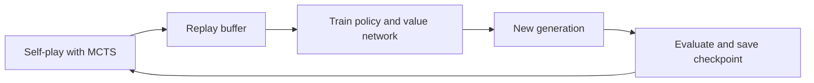

# Chess RL

A chess agent that learns by playing itself. It is built from scratch in PyTorch: a policy/value neural network, Monte Carlo Tree Search, and a self-play training loop, in the style of AlphaZero but scaled down to run on a laptop.

> **Status: work in progress, with an honest negative result.** The full pipeline runs end to end, but training does not yet improve the agent. In a 30-game evaluation against a random player, every network trained by self-play scores lower than the *untrained* network with search. This README documents the experiments, what each one showed, and what is being tried next.

## Why this project

Most chess AI demos wrap an existing engine. This project implements the learning loop itself and measures how well it works, including where it fails. The aim is to understand reinforcement learning from the inside: what the search does, what the network learns, and what goes wrong when the training signal is weak.

## How it works



### 1. Seeing the board

The network cannot read a chess board, so each position becomes a tensor of shape 13 x 8 x 8: twelve planes for the pieces (six types, two colors) and one plane that is all ones when White is to move.


### 2. The network

Three 3x3 convolutional layers (64 channels) feed two heads:

- **Policy head:** 4096 scores, one per (from-square, to-square) pair. A 1x1 convolution compresses the features first, which keeps the head small. Illegal moves are masked out before the softmax, so they get exactly zero probability.
- **Value head:** a single number in [-1, 1] estimating how good the position is for the player to move.

About 2.2 million parameters in total.

### 3. Search (Monte Carlo Tree Search)

Each move runs a number of simulations. Each simulation walks down the tree choosing the child with the best PUCT score:

```
score = -Q(child) + cPuct * prior * sqrt(parent visits) / (1 + child visits)
```

At an unexplored position the network supplies the priors (policy) and the evaluation (value), and the result is backed up the path with the sign flipped at every ply. Checkmate is detected exactly (value -1 for the side that is mated). The visit counts at the root form the **search policy**, which is both the agent's move choice and its training target. During self-play, Dirichlet noise is mixed into the root priors for exploration.

### 4. Self-play and training

The agent plays full games against itself. Every position becomes a training example:

| Part | Meaning |
|---|---|
| State | the 13 x 8 x 8 board tensor |
| Policy target | visit probabilities from the search |
| Value target | depends on the experiment: game result, or material balance (see Experiments) |

Loss = cross-entropy on the policy + mean squared error on the value. Examples go into a replay buffer, and each generation trains on random batches from it. After each generation the loop logs metrics to a CSV, plays an evaluation match, and saves a checkpoint.

## How strength is measured

All evaluations are against a random-move player, alternating colors, with games capped at 200 plies (unfinished games count as draws). The agent uses 25 search simulations per move.

- **Score** = (wins + 0.5 x draws) / games. 0.5 means no better than the opponent.
- **Material margin** = the agent's average material lead (pawn 1, knight 3, bishop 3, rook 5, queen 9) over the opponent when each game ends.

The margin was added because the win/draw score cannot see progress when games rarely end in checkmate. In a test with a simple player that always takes the best available capture, the score was 0.57 against random but the margin was +26.7, versus about +1 for random vs random.

Samples are small (30 games), so differences of a few margin points are within noise.

## Performance engineering

Profiling the search showed that the network's dense layers took about half of the time, almost all of it in the 4096-wide policy head, and that copying the board (with its move history) grew with game length.

| | Before | After |
|---|---|---|
| Time for 50 simulations (CPU, opening position) | 0.47 s | 0.16 s |
| Network parameters | about 16.9 M | about 2.2 M |
| Checkpoint size | about 67 MB | about 9 MB |

Changes: a 1x1 convolution before the policy head, and `board.copy(stack=False)` inside the search.

## Results

30 games each, against a random player, 25 simulations per move.

| Player | W / D / L | Score | Material margin |
|---|---|---|---|
| Untrained network (Gen 0) + search | 13 / 16 / 1 | **0.70** | **+4.5** |
| Run 1, gen 10 (pure self-play) | 1 / 29 / 0 | 0.52 | -7.7 |
| Run 2b, gen 10 (material scoring of drawn games) | 1 / 24 / 5 | 0.43 | -8.9 |
| Run 3, gen 5 (+ root noise) | 2 / 24 / 4 | 0.47 | -9.9 |
| Run 3, gen 10 | 0 / 25 / 5 | 0.42 | -10.1 |
| Run 3, gen 10, policy ignored (uniform priors) | 2 / 27 / 1 | 0.52 | -2.1 |
| Run 3, gen 10, value ignored (value = 0) | 1 / 27 / 2 | 0.48 | -12.8 |
| Run 4, gen 5 (dense material value targets) | 1 / 24 / 5 | 0.43 | -12.3 |
| Run 4, gen 10 | 2 / 26 / 2 | 0.50 | -9.4 |
| Value head pretrained on material (no self-play) | 0 / 29 / 1 | 0.48 | +8.0 |

## Experiments

Every run starts from the same untrained network, uses 10 generations of 8 self-play games with 40 simulations per move, and caps self-play games at 200 plies. Runs differ in the training signal.

### Run 1: pure self-play

Value target: the game result (+1 / -1 / 0) for every position. Policy loss fell from 5.73 to 1.98 and value loss from 0.19 to 0.0073, but only 3 self-play games ended in checkmate, all in generation 1, and none afterwards.


**Reading:** the losses fall, but the agent does not get stronger. Almost every game ends without a result, so the value targets are almost all zero and the search has nothing to follow except the network's own priors. The network learns to predict its own search, which is a self-confirming loop. This is the sparse-reward problem. AlphaZero avoided it with millions of games, far beyond this project's compute.

### Run 2: material scoring for unfinished games (a silent no-op)

Change: games cut off at the move cap are scored by material instead of 0. The curves came out nearly identical to run 1. Inspecting the saved games showed why: all ten ended between 31 and 77 plies in draws by repetition, so the cap was never reached and the rule never ran. A rule that never fires looks exactly like a rule that does not help, and the run was only diagnosed by looking at the games.

### Run 2b: material scoring for every non-checkmate ending

Fix: any game that does not end in checkmate or stalemate (including repetition draws) is scored by material, squashed with `tanh` and capped at +/-0.5, so a real checkmate always outweighs a material lead. The value loss now had structure (0.25 to 0.04), and 9 of 10 saved games ended with non-zero material. Strength was still below the untrained network (table above).

### Run 3: root exploration noise

Change: Dirichlet noise mixed into the root priors during self-play (25%, alpha 0.3), to stop the policy locking onto a few moves. Policy loss ended higher (2.94) because the targets stayed broader. Strength did not improve (gen 5 was already as weak as gen 10, so the damage happens early).

**Ablation (which head hurts?):** running the gen-10 network with one head switched off at a time showed that the trained **policy priors** cost about 8 margin points (-10.1 to -2.1 when ignored), while ignoring the value head changed little. Even the best variant stayed below the untrained network, so neither head had learned anything useful.

### Run 4: dense per-position material value targets

Change: each position's value target is the material balance at that position (from the mover's side), and training steps per generation were cut from 100 to 30. Games ended in checkmate more often (16 of 80), but strength did not improve.

### Can the network learn material at all? (unit test)

A fresh network was trained for 400 steps on 4,000 randomly generated positions with exact material labels (random game positions with random pieces removed and a random side to move) and tested on 1,000 unseen positions.

| Network | Correlation with true material (train / unseen) |
|---|---|
| Plain | 0.958 / 0.934 |
| Sign-aware value output | 0.932 / 0.890 |

So the architecture and the training step are fine: the failure in runs 1 to 4 comes from the **self-play training signal**, not from network capacity. Checking the value heads of runs 3 and 4 on the same unseen positions gave correlations of -0.06 and -0.03, essentially zero, so self-play did not teach them material.

### Warm start: pretrain the value head on material

Pretraining the value head on the synthetic positions (test correlation 0.936) and then using it with search, with no self-play, gives the highest material margin so far (+8.0 vs +4.5), but **no wins** (0 / 29 / 1 against 13 / 16 / 1 for the untrained network).

**Open hypothesis:** an informed value head makes the search follow a few promising lines, and with only 25 simulations over about 30 legal moves it no longer tries every move, so it misses checkmates that the untrained network finds by exploring everything. This is being tested next with a mate-in-one probe and the exploration constant `cPuct`.

## Lessons so far

- **Falling loss is not strength.** Every run's loss curve went down; none of them improved the player. Measure play, not loss.
- **Check that a change actually ran.** Run 2's new rule never fired, and only the saved games showed it.
- **Use a metric that can see progress.** The win/draw score hid large differences that the material margin showed.
- **Test components in isolation.** A two-minute supervised test ruled out the network as the cause, where a full run takes an hour.
- **Check measurements for enough independent samples.** Two early diagnostics used consecutive positions from only a few games and were discarded.

## Limitations

- Underpromotion is not supported: a pawn reaching the last rank always promotes to a queen.
- The network input does not include castling rights, en passant availability, or repetition history. Move legality is handled by python-chess, so all of these moves are still played correctly. The network just cannot use them as signals when evaluating a position.
- Inside the search, repetitions that occurred before the search started are not tracked (`board.copy(stack=False)`). The real game still ends on repetition normally.
- Material-based training targets inject domain knowledge (piece values), so they are not pure AlphaZero-style learning.
- Evaluation is against a random player only, 30 games per entry, at a low simulation budget (25).

## Roadmap

- [x] Board encoding, move encoding, legal-move masking
- [x] Policy/value network
- [x] Monte Carlo Tree Search
- [x] Self-play, replay buffer, training loop with CSV logging and checkpoints
- [x] Profile-guided speed-up
- [x] Diagnosis of why pure self-play stalls (runs 1 to 4, ablation, unit test)
- [x] Material-aware value head via pretraining
- [ ] Mate-in-one probe and exploration settings (`cPuct`, simulations)
- [ ] Self-play starting from the pretrained value head
- [ ] Longer training runs
- [ ] Strength measured against a stronger baseline, and a strength curve across generations
- [ ] Deployment as a Lichess bot
- [ ] Demo video

## Repository layout

```
chess-rl/
├── notebooks/       # the working notebook
├── docs/            # figures used in this README
├── logs/            # per-run metrics (CSV)
├── games/           # saved games (PGN)
├── checkpoints/     # model weights (not tracked by Git)
└── README.md
```